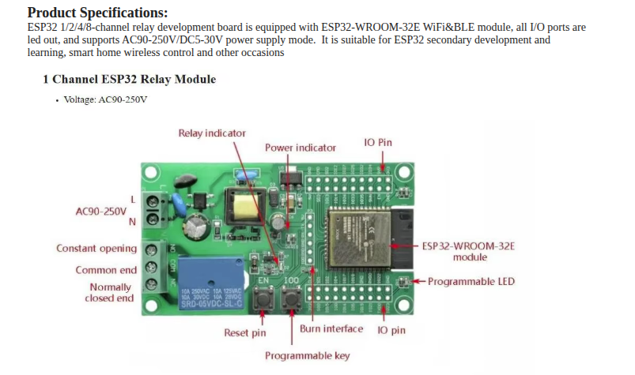

# Laundry room controll
The project is about controller that set the laundry room illumination and ventilation, the main board is ESP32 board show in image  the relay use to set the power for one out of two fans in the room the other fan control by IR led (the fan has IR reciver) the illumination in the room controll Smart switch - the switch listen to RF signal using SYN115 board so the board has small RF transmiter.  
to make it smart the board also connect to LD2410 radar sensor other sensor that connect to the board are light sensor VEML7700 temperature sensor AHT20 and BMP280 sensor.  
operation mode is that if the board detact someone entring the room (start with moving target then static target) then if it dark its turn light on and if it hot and mouster its turn the fans on, if the person left it waite 5min and turn off fan and ilumination, optional to use the light sensor to detect if the light is working.  
the board will have serial port using the blutoot to set wifi accses and show basic status such sensor halth. when wifi estabilish the board will provide server accses to set threshold parameters heat and light, show sensor read values enable disable working modes (manuel means not activate when somwone get to the room, fan control , light control) the server will in any case enable controll each of the fans and the light) all parameters include wifi connection details will save in board eprom.  
on boot the board will start the bluetoot terminal ASAP then if it has the wifi connection details it will connect to wifi it will show when in the blueooth terminal the ststus when the command was send.  
the network is mesh with few hotspots that has same connections details the board will serch for best signal.  
in the terminal geting command ? will display all accpted commands. serial port and blutoot should behave similar.  
The on board led when booting and in process of connecting will flash fast every 0.2sec but when boot compleat it will start flash slow once per sec.  
The operation of the sensors will run on one core of the ESP and the server on another core to make it responsive and never stack, the operation of the serial must be in parralen and never stack the working of board.  
at the moment I dont have the RF transmitter so I need option to controll the smart light switch from wifi.  

